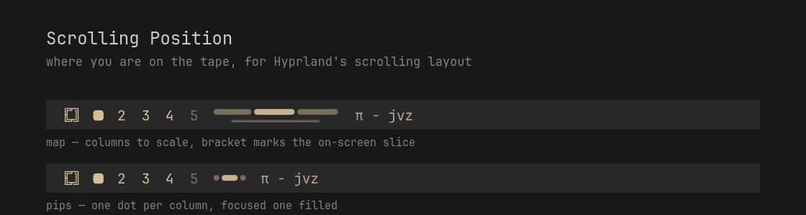

# Scrolling Position

A bar widget for [Omarchy](https://omarchy.org/) that shows where you are on the
tape when a workspace uses Hyprland's `scrolling` layout.



The scrolling layout is a one-dimensional strip of columns, usually wider than
the screen. The screen itself can only ever show you the part you are looking
at. This widget shows the part you are not: how many columns exist, which one
has focus, and how much tape is parked off each edge.

It hides itself completely on workspaces that use any other layout.

## Two modes

Click the widget to switch; the choice is written back to your `shell.json`, so
it survives a restart.

- **map** — columns drawn to scale, with a bracket underneath marking the slice
  currently on screen. Reads like a scrollbar: a wide segment is a wide column,
  and a bracket that runs off the end means empty space beyond the last column.
- **pips** — one dot per column, the focused one drawn as a filled pill.
  Position and count only, in a fraction of the width.

In both modes, opacity encodes visibility: focused, fully on screen, peeking in
at an edge, or entirely off screen.

## Requirements

- Omarchy 4 (the Quattro Quickshell shell, `omarchy-shell`)
- Hyprland with the native `scrolling` layout — developed and tested on 0.56.2
- No external dependencies: no extra packages, no helper binaries, no network
  access. The widget reads Hyprland's own IPC through Quickshell and nothing
  else.

## Install

```bash
omarchy plugin add https://github.com/PraiseTheDuck/omarchy-scrolling-position.git --enable
```

`--enable` asks which bar section to place it in. The natural spot is **left**,
directly after `omarchy.workspaces`, so workspace number and column position sit
together:

```json
"left": [
  { "id": "omarchy.workspaces" },
  { "id": "io.github.jvaxx.scrolling-position" },
  { "id": "omarchy.active-window" }
]
```

Or place it later with:

```bash
omarchy bar move io.github.jvaxx.scrolling-position --section left
```

## Remove

```bash
omarchy plugin remove io.github.jvaxx.scrolling-position
```

That deletes `~/.config/omarchy/plugins/io.github.jvaxx.scrolling-position/` and
drops the widget from the bar. The plugin writes nothing outside its own entry
in `~/.config/omarchy/shell.json`, creates no state files, and leaves no
background process behind, so nothing else needs cleaning up.

To keep the plugin installed but take it off the bar, delete its entry from the
`bar.layout` section of `shell.json`.

## Settings

Set these inline on the widget's entry in `~/.config/omarchy/shell.json`; they
hot-reload on save.

| Key | Default | What it does |
|-----|---------|--------------|
| `mode` | `"map"` | `"map"` or `"pips"`. Clicking the widget rewrites this. |
| `mapLength` | `110` | Length of the minimap along the bar, in pixels, before text scaling. Ignored in pips mode. |
| `pollInterval` | `600` | Fallback refresh in milliseconds. `0` makes the widget purely event-driven — see below. |
| `hideWhenSingleColumn` | `false` | Hide the widget when the workspace has only one column, since there is nowhere to scroll. |

```json
{ "id": "io.github.jvaxx.scrolling-position", "mode": "pips", "hideWhenSingleColumn": true }
```

## How it stays in sync

Hyprland keeps off-screen columns in `hyprctl clients` with their real
coordinates — a column parked left of the viewport reports a negative `x` — so
the whole tape can be reconstructed from geometry alone. Windows stacked in one
column share an `x`/`width` pair and collapse into a single segment.

Refreshing is the interesting part, because **Hyprland has no event for a layout
geometry change**. Verified on `.socket2`: moving focus emits `activewindowv2`,
while `layoutmsg colresize` moves every column on the tape and emits nothing at
all. So the widget uses three paths:

1. **Events.** Any Hyprland IPC event fires a three-shot refresh at 0/120/380 ms
   — one read for the dispatch, the rest for the animation settling. This covers
   all ordinary scrolling, which is focus movement, instantly.
2. **A heartbeat**, `pollInterval` (600 ms default). This is what catches the
   eventless changes: column resizes and mouse-drag resizes. An unchanged tape is
   compared by signature and dropped without repainting, so a static strip costs
   a socket read and a string compare.
3. **An IPC hook**, for anyone who would rather not poll:

   ```bash
   omarchy-shell -q io.github.jvaxx.scrolling-position refresh
   ```

   Add that line to a script that reshapes columns (a `colresize` bind, for
   instance) and the widget updates on the dispatch. With every such bind wired
   up you can set `pollInterval: 0` and run fully event-driven — at the cost of
   mouse-drag resizes, which no script can intercept, going stale until the next
   focus change.

Registering a new IPC target requires a full `omarchy restart shell`; plugin
hot-reload alone does not pick it up.

## Notes

- **Multi-monitor:** each bar reads its own screen's active workspace, not the
  focused one, so the widget on your second monitor describes that monitor's
  tape.
- **Fullscreen** needs no special handling: Hyprland gives the fullscreen window
  exactly the viewport and pushes its neighbours off both edges, which the map
  renders correctly as one column filling the screen.
- **Cold start:** Quickshell only learns the active window from an
  `activewindowv2` event and never seeds it, so the focused column falls back to
  `focusHistoryID` from the same snapshot as the geometry. The right column is
  lit on a freshly started bar, before you have touched anything.
- Floating windows and the scratchpad are excluded from the tape.
- Colors come from the active Omarchy theme (`bar.text`); there is nothing to
  configure and nothing to restyle when you switch themes.

## License

MIT — see [LICENSE](LICENSE).
